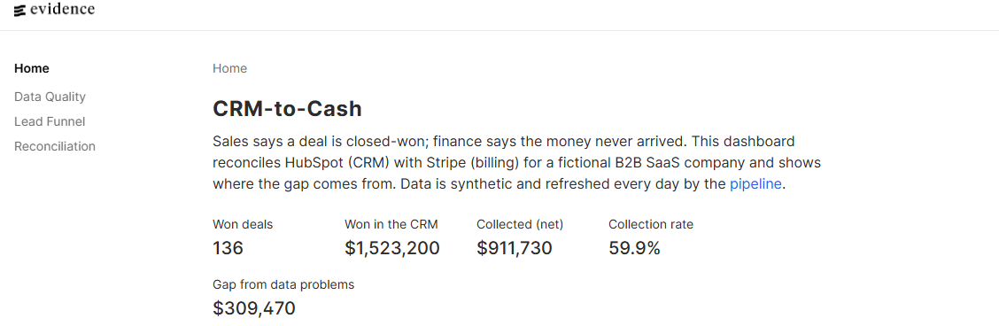
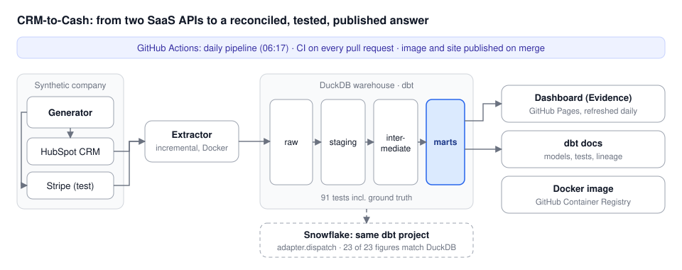

# CRM-to-Cash

[](https://github.com/GianCipollari/crm-to-cash/actions/workflows/ci.yml)
[](https://github.com/GianCipollari/crm-to-cash/actions/workflows/daily_pipeline.yml)
[](https://giancipollari.github.io/crm-to-cash/)
[](https://giancipollari.github.io/crm-to-cash/docs/)

> Sales says a deal is closed-won. Finance says the money never arrived.
> **CRM-to-Cash reconciles the CRM with billing every day and shows where the gap comes from.**

An end-to-end data pipeline: incremental extraction from the HubSpot and Stripe APIs, dbt
models tested against a known answer, a public dashboard refreshed daily, and the same dbt
project running on DuckDB and Snowflake. It runs on GitHub Actions at no cost.

**[Open the live dashboard](https://giancipollari.github.io/crm-to-cash/)** ·
**[Browse the dbt docs and lineage](https://giancipollari.github.io/crm-to-cash/docs/)**



## The problem

In most B2B companies the CRM (what sales reports) and the billing system (what finance
collects) never fully agree. This project answers four questions:

1. What share of closed-won revenue is actually invoiced and collected?
2. Where is the gap: deals never invoiced, unpaid or partial invoices, unrecorded discounts,
   duplicate deals, refunds?
3. Which lead sources bring customers who actually pay, not only customers who sign?
4. How reliable is the CRM data?

The data belongs to a fictional LatAm B2B SaaS company, generated on purpose with nine kinds
of real-world data problems. Every planted problem is recorded, so the pipeline's answers can
be tested against a known truth.

## How it works



1. **Generate:** a deterministic Python generator creates the company in HubSpot and Stripe
   (test mode) and adds new activity every day.
2. **Extract:** an incremental extractor reads only new and changed records from both APIs,
   with retries, cursors and idempotent loads into DuckDB.
3. **Transform:** dbt builds staging, intermediate and mart models. Intermediate matches
   companies to billing customers in three passes and invoices to deals in two.
4. **Test:** 91 dbt nodes run on every build, including tests that compare what the pipeline
   detects with the list of planted problems.
5. **Publish:** GitHub Actions runs everything daily and publishes the dashboard and the dbt
   docs; every pull request runs the full project on API-shaped fixtures, without secrets.

## Results

| | |
| --- | --- |
| Planted data problems detected | 9 of 9 types, every planted record |
| dbt build | 91 of 91 nodes passing, locally, in CI and daily |
| Warehouses | DuckDB (daily) and Snowflake: 23 of 23 summary figures identical |
| Snowflake cost to build and verify | 0.1079 credits (36 s per full build) |
| Running cost | $0: GitHub Actions, GitHub Pages and free API tiers |

## Engineering highlights

- **Tested against ground truth.** The generator writes a manifest of every problem it plants;
  dbt tests fail if any planted problem goes undetected and warn about unexplained extra
  detections. These tests found two real modelling bugs during development (a duplicate rule
  that flagged two genuine sales, and one-status-per-deal hiding discounts on unpaid invoices).
  [ADR 0004](docs/decisions/0004-matching-strategy.md)
- **Incremental, idempotent extraction.** HubSpot by modification time with a `GTE` cursor;
  Stripe by creation time plus a re-check of invoices still open, since Stripe has no
  modification timestamp. Running twice writes nothing.
  [ADR 0003](docs/decisions/0003-incremental-extraction.md)
- **Explainable matching.** Every customer and invoice match records the method that resolved
  it (exact id, email domain, normalized name; deal reference or company + amount + date).
- **One dbt project, two warehouses.** Engine-specific SQL lives in macros with
  `adapter.dispatch`; a comparison script checks both warehouses agree.
  [ADR 0006](docs/decisions/0006-snowflake-and-dashboard.md)
- **CI without secrets.** Pull requests build the whole project, dashboard included, on
  fixtures generated from the seed with the same JSON shape as the APIs.
  [ADR 0005](docs/decisions/0005-orchestration-and-ci-cd.md)
- **Safe by default.** Stripe loads refuse live keys and use idempotency keys; Snowflake uses
  key-pair authentication, an auto-suspending warehouse and a credit cap.

## Tech stack

| Area | Tools |
| --- | --- |
| Extraction and loading | Python, `requests`, HubSpot CRM API, Stripe API, Docker |
| Warehouse | DuckDB (daily), Snowflake (second target) |
| Transformation and testing | dbt Core (staging, intermediate, marts, snapshot, unit tests, ground-truth tests), Jinja macros |
| Orchestration and CI/CD | GitHub Actions, Actions cache, GitHub Container Registry |
| Dashboard and docs | Evidence, dbt docs, GitHub Pages |
| Quality | pytest (52 tests), 91 dbt nodes, source freshness |

## Run it locally

```bash
make install          # Python dependencies
make test             # offline unit tests
make preview          # build the synthetic company as CSVs, no accounts needed
make ci-dbt           # what CI runs: full dbt build on fixtures, no accounts needed
```

With your own free accounts (HubSpot developer test account, Stripe test mode):

```bash
make seed                        # load the company (see docs/setup_accounts.md)
python -m extractor.cli          # incremental extraction into out/warehouse.duckdb
cd dbt && dbt deps && dbt build  # transform and test
```

Snowflake setup: [docs/setup_snowflake.md](docs/setup_snowflake.md). Everything also runs in
Docker: `docker compose run --rm app`.

## Repository layout

```
generator/     synthetic company, daily activity, HubSpot and Stripe loaders, CI fixtures
extractor/     incremental extraction, raw storage, Snowflake loader, warehouse comparison
dbt/           staging, intermediate, marts, snapshot, seeds (anomaly manifest), tests
dashboard/     Evidence pages (built and published by the daily pipeline)
tests/         Python unit tests, no network needed
docs/          setup guides, architecture decisions (ADRs), images
.github/       workflows: ci, daily-pipeline (also publishes the site), cd (image)
```

## Architecture decisions

| ADR | Decision |
| --- | --- |
| [0001](docs/decisions/0001-synthetic-data.md) | Deterministic synthetic data with a ground-truth manifest |
| [0002](docs/decisions/0002-daily-activity.md) | Stateless, idempotent daily activity |
| [0003](docs/decisions/0003-incremental-extraction.md) | Incremental extraction strategy per API |
| [0004](docs/decisions/0004-matching-strategy.md) | Matching CRM and billing records |
| [0005](docs/decisions/0005-orchestration-and-ci-cd.md) | GitHub Actions for orchestration and CI/CD |
| [0006](docs/decisions/0006-snowflake-and-dashboard.md) | Snowflake as a second target, Evidence dashboard |

## What I'd do next

- Move orchestration to Airflow or Dagster once there are more sources and dependencies.
- Replace the Actions cache with a shared warehouse (MotherDuck or Snowflake) for durability.
- Incremental dbt models and data contracts on the raw sources.
- Alerts to Slack or email when freshness or ground-truth tests fail.
- Multi-currency amounts and deleted-record handling in the extractor.

## License

[MIT](LICENSE) · Built by Gianfranco Cipollari.
